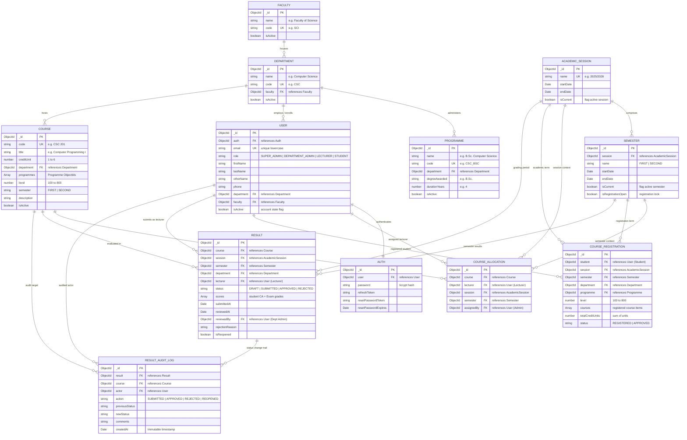

# University Education Management Portal (UEMP)

A modern, full-stack, enterprise-grade University Education Management Portal built with **Next.js (App Router)**, **Node.js / Express**, **TypeScript**, and **MongoDB (Mongoose)**.

---

## 📋 System Overview & Architecture

UEMP is an institutional portal designed to handle core academic operations with strict **Role-Based Access Control (RBAC)** across four distinct application roles:
- **Super Administrator**: Overall university control, academic structure, user accounts, and system-wide monitoring.
- **Department Administrator**: Department-scoped operations, student management, course allocations, and result approvals.
- **Lecturer**: Assigned course management, student class lists, CA/Exam score entry, and result submission.
- **Student**: Course registration, registered course units, academic history, CGPA tracking, and printable statements.

```
                              ┌─────────────────────────────────────────┐
                              │            Next.js Frontend             │
                              │       (TailwindCSS, Zustand, Radix)     │
                              └────────────────────┬────────────────────┘
                                                   │ HTTP / REST (JWT)
                                                   ▼
                              ┌─────────────────────────────────────────┐
                              │           Node.js / Express API         │
                              │         (TypeScript, RBAC, Zod)         │
                              └────────────────────┬────────────────────┘
                                                   │ Mongoose ODM
                                                   ▼
                              ┌─────────────────────────────────────────┐
                              │             MongoDB Database            │
                              │    (Users, Courses, Results, Audits)    │
                              └─────────────────────────────────────────┘
```

---

## 🔑 Test Login Credentials

All test accounts use the default password: **`Password123!`**

| Role | Email Address | Identifier / Code | Primary Scope |
| :--- | :--- | :--- | :--- |
| **Super Admin** | `superadmin@uemp.edu.ng` | `ROOT/001` | University-Wide Oversight |
| **Department Admin** | `deptadmin.cs@uemp.edu.ng` | `ADM/CSC/01` | Computer Science Department |
| **Lecturer 1** | `lecturer.smith@uemp.edu.ng` | `STF/CSC/101` | Senior Lecturer (CSC 201, CSC 205) |
| **Lecturer 2** | `lecturer.doe@uemp.edu.ng` | `STF/CSC/102` | Lecturer II (CSC 203) |
| **Student 1 (200L)** | `student.emeka@uemp.edu.ng` | `UEMP/2024/001` | Computer Science (Results Available) |
| **Student 2 (200L)** | `student.fatima@uemp.edu.ng` | `UEMP/2024/002` | Computer Science (Results Available) |
| **Student 3 (100L)** | `student.kemi@uemp.edu.ng` | `UEMP/2025/001` | Fresh Student (Registration Workflow) |

---

## 🔄 Core Workflows Implemented

### 1. Student Course Registration Workflow
1. Student signs in &rarr; System auto-detects department, programme, and current academic level.
2. Displays eligible courses for the current active semester.
3. Validates against duplicate registration and maximum credit unit limits.
4. Generates an instant printable Course Registration Summary with institutional header.

### 2. Lecturer Result Submission Workflow
1. Lecturer logs in &rarr; Views only assigned courses.
2. Selects assigned course to view the registered student roster.
3. Inputs Continuous Assessment (CA) and Examination scores.
4. Auto-computes Total Score, Grade, and Grade Point on a 5.0 scale (A=5, B=4, C=3, D=2, E=1, F=0).
5. Saves as `DRAFT` or submits for departmental review (`SUBMITTED`).
6. System generates an audit log entry for traceability.

### 3. Departmental Result Approval Workflow
1. Department Admin logs in &rarr; Navigates to pending result approval queue.
2. Inspects submitted score sheets.
3. **Approve**: Changes status to `APPROVED`, publishing grades to students and auto-updating GPA/CGPA.
4. **Reject / Return**: Reopens the sheet with correction comments for the lecturer.
5. Strict rule: Lecturers cannot approve their own submitted scores.

### 4. Super Admin Management Workflow
1. Super Admin manages university faculties, departments, programmes, sessions, and semesters.
2. User directory with full search, role tabs, department scoping, and account status toggles.
3. RBAC safeguards: Protected root accounts, self-account status protection, and audit logs.

---

## 🗄️ Database Architecture & Entity-Relationship (ER) Diagram

UEMP utilizes **MongoDB (via Mongoose ODM)** with strongly-typed schemas, embedded sub-documents for role-specific attributes, and compound unique indexes enforcing institutional integrity (e.g., preventing duplicate course allocations, single registration sheets per semester, and conflict-free grading sheets).

### 📊 Entity-Relationship (ER) Diagram



---

### 📑 Detailed Schema Specifications

#### 1. Identity & Access Governance
| Collection | Field | Type | Constraint | Description |
| :--- | :--- | :--- | :--- | :--- |
| **`User`** | `_id` | `ObjectId` | Primary Key | System user identifier |
| | `email` | `String` | Unique, Required | University email address |
| | `role` | `Enum` | Required | `SUPER_ADMIN`, `DEPARTMENT_ADMIN`, `LECTURER`, `STUDENT` |
| | `firstName` / `lastName` | `String` | Required | Legal names |
| | `department` | `ObjectId` | Ref &rarr; Department | Departmental affiliation (null for Super Admin) |
| | `faculty` | `ObjectId` | Ref &rarr; Faculty | Faculty affiliation |
| | `studentProfile` | `Subdoc` | Optional | `{ matricNumber, programme, level, entrySession }` |
| | `lecturerProfile` | `Subdoc` | Optional | `{ staffId, title, designation }` |
| | `isActive` | `Boolean` | Default: `true` | Account suspension toggle |
| **`Auth`** | `user` | `ObjectId` | Ref &rarr; User, Unique | 1:1 association to User |
| | `password` | `String` | Required | Encrypted bcrypt password hash |
| | `refreshToken` | `String` | Indexed | Revocable JWT session token |

#### 2. Institutional Hierarchy & Academic Calendar
| Collection | Key Fields | References | Business Rules / Constraints |
| :--- | :--- | :--- | :--- |
| **`Faculty`** | `name`, `code`, `isActive` | None | `code` is unique uppercase (e.g. `SCI`, `ENG`) |
| **`Department`** | `name`, `code`, `faculty`, `isActive` | `Faculty` | Belongs to a parent faculty; `code` is unique |
| **`Programme`** | `name`, `code`, `department`, `degreeAwarded`, `durationYears` | `Department` | e.g. B.Sc. Computer Science (4 years) |
| **`AcademicSession`** | `name`, `startDate`, `endDate`, `isCurrent` | None | Exactly one session marked `isCurrent: true` at a time |
| **`Semester`** | `session`, `name` (`FIRST`/`SECOND`), `isCurrent`, `isRegistrationOpen` | `AcademicSession` | Controls student registration window |

#### 3. Course Management & Allocations
| Collection | Key Fields | References | Unique Indexes / Invariants |
| :--- | :--- | :--- | :--- |
| **`Course`** | `code`, `title`, `creditUnit` (1-6), `level` (100-800), `semester` | `Department`, `Programme[]` | `code` unique (e.g. `CSC 201`). Scoped to department |
| **`CourseAllocation`** | `course`, `lecturer`, `session`, `semester`, `assignedBy` | `Course`, `User`, `AcademicSession`, `Semester` | **Compound Unique**: `{ course: 1, session: 1, semester: 1 }` (one lecturer per course/term) |
| **`CourseRegistration`** | `student`, `session`, `semester`, `department`, `courses[]`, `totalCreditUnits` | `User`, `AcademicSession`, `Semester`, `Course` | **Compound Unique**: `{ student: 1, session: 1, semester: 1 }` (max 1 registration sheet per student/term) |

#### 4. Examination, Grading & Audit Log
| Collection | Key Fields | References | State Lifecycle & Validation |
| :--- | :--- | :--- | :--- |
| **`Result`** | `course`, `session`, `semester`, `department`, `lecturer`, `status`, `scores[]`, `reviewedBy` | `Course`, `User`, `AcademicSession`, `Semester` | **Compound Unique**: `{ course: 1, session: 1, semester: 1 }`<br/>Status: `DRAFT` &rarr; `SUBMITTED` &rarr; `APPROVED` or `REJECTED` |
| **`scores[]`** *(Subdoc)* | `student`, `caScore` (0-40), `examScore` (0-70), `totalScore` (0-100), `grade`, `gradePoint` | `User` (Student) | Auto-graded: 70-100 &rarr; A(5), 60-69 &rarr; B(4), 50-59 &rarr; C(3), 45-49 &rarr; D(2), 40-44 &rarr; E(1), 0-39 &rarr; F(0) |
| **`ResultAuditLog`** | `result`, `course`, `actor`, `action`, `previousStatus`, `newStatus`, `comments` | `Result`, `Course`, `User` | **Append-only immutable log** capturing every submission, approval, rejection, and reopening with timestamps |

---


## 🚀 Local Installation & Setup

### Prerequisites
- Node.js (v18 or newer)
- MongoDB (Local instance or MongoDB Atlas cluster)

### 1. Backend Setup (`server/`)
```bash
cd server
npm install
npm run seed     # Seeds the database with all roles, courses, and sample workflows
npm run dev      # Starts API server on http://localhost:5000
```

### 2. Frontend Setup (`client/`)
```bash
cd client
npm install
npm run dev      # Starts Next.js application on http://localhost:3000
```

### 3. Build for Production
- **Server**: `npm run build` (outputs to `server/dist/`)
- **Client**: `npm run build` (Next.js production bundle)

---

## 🛡️ Security Implementation
- **JWT Authentication**: Short-lived access tokens with secure refresh tokens in HTTP cookies.
- **Backend Route Guards**: Role-based middleware (`authorizeRoles`) and Department Scope filters on API endpoints.
- **Data Integrity**: Input validation via Zod schemas and unique compound indices on MongoDB models.
- **Audit Logging**: Traceability for all administrative and academic actions.
