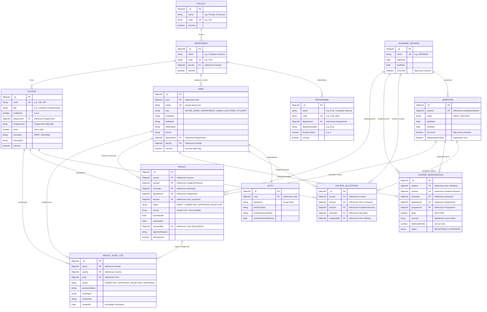

# University Education Management Portal (UEMP)

A modern, full-stack, enterprise-grade University Education Management Portal built with **Next.js (App Router)**, **Node.js / Express**, **TypeScript**, and **MongoDB (Mongoose)**.

---

## 📋 System Overview & Architecture

UEMP is an institutional portal designed to handle core academic operations with strict **Role-Based Access Control (RBAC)** across four distinct application roles:
- **Super Administrator**: Overall university control, academic structure, user accounts, and system-wide monitoring.
- **Department Administrator**: Department-scoped operations, student management, course allocations, and result approvals.
- **Lecturer**: Assigned course management, student class lists, CA/Exam score entry, and result submission.
- **Student**: Course registration, registered course units, academic history, CGPA tracking, and printable statements.

```
                              ┌─────────────────────────────────────────┐
                              │            Next.js Frontend             │
                              │     (App Router, TanStack, Tailwind)    │
                              └────────────────────┬────────────────────┘
                                                   │ HTTP / REST (JWT in Cookie)
                                                   ▼
                              ┌─────────────────────────────────────────┐
                              │           Node.js / Express API         │
                              │       (TypeScript, RBAC, Zod, Multer)   │
                              └────────────────────┬────────────────────┘
                                                   │ Mongoose ODM
                                                   ▼
                              ┌─────────────────────────────────────────┐
                              │             MongoDB Database            │
                              │    (Users, Courses, Results, Audits)    │
                              └─────────────────────────────────────────┘
```

### 🏛️ Architectural Decisions & Technical Rationale

1. **Decoupled Frontend / Backend Architecture**:
   - The frontend is an independent Next.js 14 application communicating with a dedicated Node.js / Express REST API over standardized JSON. This ensures clear separation of concerns, independent deployment pipelines (e.g. Render for server, Vercel/Render for client), and prevents tight coupling.
2. **Stateless JWT with Dual-Token Rotation**:
   - Authentication relies on short-lived signed JWT access tokens transmitted via HTTP Authorization headers and revocable refresh tokens maintained in secure HTTP-only cookies. This eliminates server session state bottlenecks while guaranteeing instant session revocation.
3. **Multi-Tenant Department Data Isolation (Backend-Enforced Scoping)**:
   - Data segregation for Department Administrators is not trusted to frontend query parameters. Instead, the backend authorization middleware decodes the admin's institutional department from the verified JWT and injects `req.user.department` directly into MongoDB queries.
4. **Data Integrity via Compound Unique Indexes**:
   - Institutional constraints are enforced at the database level using compound unique indexes—preventing double allocations (`course + session + semester`), multiple active registrations (`student + session + semester`), and duplicated result submissions.
5. **Auditable Result Life-Cycle Engine**:
   - Result sheets transition through a finite state machine (`DRAFT` &rarr; `SUBMITTED` &rarr; `APPROVED` / `REJECTED`). Every transition automatically creates an immutable `ResultAuditLog` entry tracking the actor, previous status, new status, timestamp, and comments.

### 💻 Technology Stack

| Layer | Technologies & Libraries | Purpose |
| :--- | :--- | :--- |
| **Frontend Framework** | **Next.js 14** (App Router), **React 18**, **TypeScript** | Server & Client component rendering, dynamic routing |
| **Styling & UI Components** | **TailwindCSS**, **Radix UI Primitives**, **Lucide React** | Responsive institutional design, accessible modals & drawers |
| **Client State & Caching** | **TanStack Query (React Query v5)**, **Zustand** | Server state caching, optimistic mutations, auth session storage |
| **Backend Runtime & API** | **Node.js (v18+)**, **Express.js**, **TypeScript** | Scalable, typed RESTful API server |
| **Database & ODM** | **MongoDB (Atlas / Community)**, **Mongoose ODM** | Document database with strongly-typed schemas and compound indexes |
| **Validation & Security** | **Zod**, **bcryptjs**, **jsonwebtoken**, **cors**, **helmet** | Schema validation, password hashing, and token verification |
| **File / Media Handling** | **Multer**, **Cloudinary SDK** | Profile avatar uploads and document handling |


---

## 🔑 Test Login Credentials

All test accounts use the default password: **`Password123!`**

| Role | Email Address | Identifier / Code | Primary Scope |
| :--- | :--- | :--- | :--- |
| **Super Admin** | `superadmin@uemp.edu.ng` | `ROOT/001` | University-Wide Oversight |
| **Department Admin** | `deptadmin.cs@uemp.edu.ng` | `ADM/CSC/01` | Computer Science Department |
| **Lecturer 1** | `lecturer.smith@uemp.edu.ng` | `STF/CSC/101` | Senior Lecturer (CSC 201, CSC 205) |
| **Lecturer 2** | `lecturer.doe@uemp.edu.ng` | `STF/CSC/102` | Lecturer II (CSC 203) |
| **Student 1 (200L)** | `student.emeka@uemp.edu.ng` | `UEMP/2024/001` | Computer Science (Results Available) |
| **Student 2 (200L)** | `student.fatima@uemp.edu.ng` | `UEMP/2024/002` | Computer Science (Results Available) |
| **Student 3 (100L)** | `student.kemi@uemp.edu.ng` | `UEMP/2025/001` | Fresh Student (Registration Workflow) |

---

## 🔄 Core Workflows Implemented

### 1. Student Course Registration Workflow
1. Student signs in &rarr; System auto-detects department, programme, and current academic level.
2. Displays eligible courses for the current active semester.
3. Validates against duplicate registration and maximum credit unit limits.
4. Generates an instant printable Course Registration Summary with institutional header.

### 2. Lecturer Result Submission Workflow
1. Lecturer logs in &rarr; Views only assigned courses.
2. Selects assigned course to view the registered student roster.
3. Inputs Continuous Assessment (CA) and Examination scores.
4. Auto-computes Total Score, Grade, and Grade Point on a 5.0 scale (A=5, B=4, C=3, D=2, E=1, F=0).
5. Saves as `DRAFT` or submits for departmental review (`SUBMITTED`).
6. System generates an audit log entry for traceability.

### 3. Departmental Result Approval Workflow
1. Department Admin logs in &rarr; Navigates to pending result approval queue.
2. Inspects submitted score sheets.
3. **Approve**: Changes status to `APPROVED`, publishing grades to students and auto-updating GPA/CGPA.
4. **Reject / Return**: Reopens the sheet with correction comments for the lecturer.
5. Strict rule: Lecturers cannot approve their own submitted scores.

### 4. Super Admin Management Workflow
1. Super Admin manages university faculties, departments, programmes, sessions, and semesters.
2. User directory with full search, role tabs, department scoping, and account status toggles.
3. RBAC safeguards: Protected root accounts, self-account status protection, and audit logs.

---

## 🔐 Permission Logic & RBAC Enforcement

The platform enforces strict **Role-Based Access Control (RBAC)** across the complete request-response cycle through 5 distinct security rings:

1. **Client-Side Route Protection & Dynamic Shell**:
   - Frontend routes (`/student/*`, `/lecturer/*`, `/dept-admin/*`, `/admin/*`) are wrapped in authentication guards. Unauthenticated attempts are redirected to `/login`, while authenticated users visiting unauthorized paths are redirected to their designated role dashboard.
2. **Token Verification Middleware (`authenticate`)**:
   - Inspects `Authorization: Bearer <token>` or secure HTTP cookie. Decodes and verifies the JWT signature, loads the user record from the database, and asserts that the user account is active (`isActive: true`). Inactive/suspended accounts are immediately rejected with HTTP `403 Forbidden`.
3. **Role Authorization Middleware (`authorize(...roles)`)**:
   - Guards endpoints by asserting `roles.includes(req.user.role)`. Attempts by students to reach lecturer/admin routes or lecturers to reach admin routes fail immediately with HTTP `403`.
4. **Dynamic Department Scope Injection**:
   - For `DEPARTMENT_ADMIN` requests, the controller injects `query.department = req.user.department` directly into database queries. Department admins can never read, modify, or approve records from other departments, regardless of what query parameters are passed in the HTTP request.
5. **Institutional Conflict-of-Interest Safeguards**:
   - **Self-Approval Prohibition**: A lecturer who also holds administrative privileges cannot approve their own submitted result sheets (`result.lecturer !== req.user._id`).
   - **Result State Visibility**: Students can only query results where `status === "APPROVED"`. `DRAFT`, `SUBMITTED`, or `REJECTED` scores are completely inaccessible to student accounts.
   - **Account Protection**: Super Admin accounts cannot be deactivated by other admins, and logged-in administrators cannot deactivate their own accounts.

### 🛡️ Role-Based Permission Matrix

| Feature / System Capability | Super Admin | Department Admin | Lecturer | Student |
| :--- | :---: | :---: | :---: | :---: |
| **Manage Faculties, Departments & Programmes** | ✅ Full Access | ❌ | ❌ | ❌ |
| **Manage Academic Sessions & Semesters** | ✅ Full Access | ❌ | ❌ | ❌ |
| **Create & Edit User Accounts** | ✅ All Roles | ✅ Dept Users | ❌ | ❌ |
| **Suspend / Deactivate Accounts** | ✅ Yes | ❌ (§2.D Rule) | ❌ | ❌ |
| **Create & Update Courses** | ✅ Yes | ✅ Dept Only | ❌ | ❌ |
| **Allocate Courses to Lecturers** | ✅ Yes | ✅ Dept Only | ❌ | ❌ |
| **Register Semester Courses** | ❌ | ❌ | ❌ | ✅ Self Only |
| **View Course Class Rosters** | ✅ All | ✅ Dept Only | ✅ Assigned | ❌ |
| **Enter CA & Exam Scores (Draft)** | ❌ | ❌ | ✅ Assigned | ❌ |
| **Submit Results for Review** | ❌ | ❌ | ✅ Assigned | ❌ |
| **Approve / Reject Department Results** | ✅ Oversight | ✅ Dept Only | ❌ (Strict) | ❌ |
| **Reopen Approved/Rejected Results** | ✅ Yes | ✅ Dept Only | ❌ | ❌ |
| **View Official Results & CGPA** | ✅ All | ✅ Dept Only | ✅ Assigned | ✅ Self Only |
| **Print Course Registration Form** | ❌ | ❌ | ❌ | ✅ Self Only |
| **Print Statement of Results** | ❌ | ❌ | ❌ | ✅ Self Only |
| **View Institutional Audit Logs** | ✅ All | ✅ Dept Logs | ❌ | ❌ |

---

## 🗄️ Database Architecture & Entity-Relationship (ER) Diagram


UEMP utilizes **MongoDB (via Mongoose ODM)** with strongly-typed schemas, embedded sub-documents for role-specific attributes, and compound unique indexes enforcing institutional integrity (e.g., preventing duplicate course allocations, single registration sheets per semester, and conflict-free grading sheets).

### 📊 Entity-Relationship (ER) Diagram



---

### 📑 Detailed Schema Specifications

#### 1. Identity & Access Governance
| Collection | Field | Type | Constraint | Description |
| :--- | :--- | :--- | :--- | :--- |
| **`User`** | `_id` | `ObjectId` | Primary Key | System user identifier |
| | `email` | `String` | Unique, Required | University email address |
| | `role` | `Enum` | Required | `SUPER_ADMIN`, `DEPARTMENT_ADMIN`, `LECTURER`, `STUDENT` |
| | `firstName` / `lastName` | `String` | Required | Legal names |
| | `department` | `ObjectId` | Ref &rarr; Department | Departmental affiliation (null for Super Admin) |
| | `faculty` | `ObjectId` | Ref &rarr; Faculty | Faculty affiliation |
| | `studentProfile` | `Subdoc` | Optional | `{ matricNumber, programme, level, entrySession }` |
| | `lecturerProfile` | `Subdoc` | Optional | `{ staffId, title, designation }` |
| | `isActive` | `Boolean` | Default: `true` | Account suspension toggle |
| **`Auth`** | `user` | `ObjectId` | Ref &rarr; User, Unique | 1:1 association to User |
| | `password` | `String` | Required | Encrypted bcrypt password hash |
| | `refreshToken` | `String` | Indexed | Revocable JWT session token |

#### 2. Institutional Hierarchy & Academic Calendar
| Collection | Key Fields | References | Business Rules / Constraints |
| :--- | :--- | :--- | :--- |
| **`Faculty`** | `name`, `code`, `isActive` | None | `code` is unique uppercase (e.g. `SCI`, `ENG`) |
| **`Department`** | `name`, `code`, `faculty`, `isActive` | `Faculty` | Belongs to a parent faculty; `code` is unique |
| **`Programme`** | `name`, `code`, `department`, `degreeAwarded`, `durationYears` | `Department` | e.g. B.Sc. Computer Science (4 years) |
| **`AcademicSession`** | `name`, `startDate`, `endDate`, `isCurrent` | None | Exactly one session marked `isCurrent: true` at a time |
| **`Semester`** | `session`, `name` (`FIRST`/`SECOND`), `isCurrent`, `isRegistrationOpen` | `AcademicSession` | Controls student registration window |

#### 3. Course Management & Allocations
| Collection | Key Fields | References | Unique Indexes / Invariants |
| :--- | :--- | :--- | :--- |
| **`Course`** | `code`, `title`, `creditUnit` (1-6), `level` (100-800), `semester` | `Department`, `Programme[]` | `code` unique (e.g. `CSC 201`). Scoped to department |
| **`CourseAllocation`** | `course`, `lecturer`, `session`, `semester`, `assignedBy` | `Course`, `User`, `AcademicSession`, `Semester` | **Compound Unique**: `{ course: 1, session: 1, semester: 1 }` (one lecturer per course/term) |
| **`CourseRegistration`** | `student`, `session`, `semester`, `department`, `courses[]`, `totalCreditUnits` | `User`, `AcademicSession`, `Semester`, `Course` | **Compound Unique**: `{ student: 1, session: 1, semester: 1 }` (max 1 registration sheet per student/term) |

#### 4. Examination, Grading & Audit Log
| Collection | Key Fields | References | State Lifecycle & Validation |
| :--- | :--- | :--- | :--- |
| **`Result`** | `course`, `session`, `semester`, `department`, `lecturer`, `status`, `scores[]`, `reviewedBy` | `Course`, `User`, `AcademicSession`, `Semester` | **Compound Unique**: `{ course: 1, session: 1, semester: 1 }`<br/>Status: `DRAFT` &rarr; `SUBMITTED` &rarr; `APPROVED` or `REJECTED` |
| **`scores[]`** *(Subdoc)* | `student`, `caScore` (0-40), `examScore` (0-70), `totalScore` (0-100), `grade`, `gradePoint` | `User` (Student) | Auto-graded: 70-100 &rarr; A(5), 60-69 &rarr; B(4), 50-59 &rarr; C(3), 45-49 &rarr; D(2), 40-44 &rarr; E(1), 0-39 &rarr; F(0) |
| **`ResultAuditLog`** | `result`, `course`, `actor`, `action`, `previousStatus`, `newStatus`, `comments` | `Result`, `Course`, `User` | **Append-only immutable log** capturing every submission, approval, rejection, and reopening with timestamps |

---


## 🚀 Local Installation & Setup

### Prerequisites
- **Node.js**: v18.x or v20.x or newer
- **npm**: v9+ (or pnpm/yarn)
- **MongoDB**: Local MongoDB instance (`mongodb://localhost:27017`) or free MongoDB Atlas URI

---

### 1. Environment Configuration

#### Backend Configuration (`server/.env`)
Create a `.env` file in the `server/` directory:
```env
# Application Environment
NODE_ENV=development
PORT=5000
API_PREFIX=/api/v1
CORS_ORIGIN=http://localhost:3000

# MongoDB Connection
MONGO_URI=mongodb://127.0.0.1:27017/uemp_db

# JWT Secrets & Expiration
JWT_SECRET=uemp-education-portal-secure-jwt-access-secret-2026
JWT_EXPIRES_IN=7d
JWT_REFRESH_SECRET=uemp-education-portal-secure-jwt-refresh-secret-2026
JWT_REFRESH_EXPIRES_IN=30d
```

#### Frontend Configuration (`client/.env.local`)
Create a `.env.local` file in the `client/` directory:
```env
NEXT_PUBLIC_API_URL=http://localhost:5000/api/v1
```

---

### 2. Backend Setup & Seeding (`server/`)
```bash
cd server
npm install

# Seed default institutional structure, test accounts, courses, and sample workflows
npm run seed

# Start server in watch mode on http://localhost:5000
npm run dev
```

> **Seeding Note**: `npm run seed` creates the active session (`2025/2026`), active semester (`FIRST`), Department of Computer Science, all 4 user roles with default passwords, course offerings (`CSC 201`, `CSC 203`, `CSC 205`), allocations, and pre-populated result sheets ready for immediate testing.

---

### 3. Frontend Setup (`client/`)
```bash
cd client
npm install

# Start Next.js client on http://localhost:3000
npm run dev
```

---

### 4. Production Build Verification
To validate that both applications build without TypeScript or bundling issues:
```bash
# Server Build (Outputs compiled TypeScript to server/dist/)
cd server && npm run build

# Client Build (Compiles production Next.js application bundle)
cd client && npm run build
```

---

## 🛡️ Security Implementation Details

1. **Authentication & Token Lifecycle**:
   - Access tokens are cryptographically signed with HMAC-SHA256 and expire in 7 days.
   - Long-lived refresh tokens are stored in the database (`Auth.refreshToken`) and transmitted via secure, HttpOnly, SameSite cookies to protect against Cross-Site Scripting (XSS) and token theft.
   - On password change or explicit logout, refresh tokens are cleared in the database, immediately invalidating compromised sessions.
2. **Password Security**:
   - Passwords are salted and hashed using `bcryptjs` with an adaptive cost factor of 12 rounds before persistent storage. Plaintext passwords are never logged or stored.
3. **Database-Level Multi-Tenancy & Scoping**:
   - For `DEPARTMENT_ADMIN` requests, the server dynamically enforces departmental scoping. `req.user.department` is extracted from verified JWT claims and applied directly to MongoDB queries, guaranteeing that departmental administrators cannot access or modify academic data belonging to other departments.
4. **Input Validation & Sanitization**:
   - API endpoints validate payload structure and constraints using schema validators.
   - Scores are mathematically bounded: Continuous Assessment (CA) is clamped between `0` and `40`, and Examination is clamped between `0` and `70`. Total scores strictly sum to `100`.
   - String inputs undergo trimming and regex matching (e.g. valid email patterns and uppercase normalization for course codes).
5. **Tamper-Evident Audit Logging**:
   - High-consequence academic operations (score submissions, approvals, rejections, and reopening) generate immutable `ResultAuditLog` records containing the actor's ID, action type, previous status, new status, timestamp, and optional explanatory notes.

---

## 🧪 Evaluator Walkthrough & Testing Guide

To rapidly verify the requirements within minutes, test the four core workflows in sequence using the provided test credentials:

### Workflow 1: Student Course Registration
1. Navigate to `http://localhost:3000/login` and log in as **Fresh Student** (`student.kemi@uemp.edu.ng` / `Password123!`).
2. Notice the system automatically identifies her department (Computer Science) and academic level (100L).
3. Navigate to **Course Registration**:
   - Select available courses for the first semester.
   - Observe total registered credit unit calculation.
   - Click **Submit Registration**.
4. Click **Print Summary** to generate the official printable course registration summary.

### Workflow 2: Lecturer Score Entry & Submission
1. Log in as **Lecturer** (`lecturer.smith@uemp.edu.ng` / `Password123!`).
2. Navigate to **Assigned Courses**:
   - Observe only courses assigned to Dr. Smith appear (`CSC 201`, `CSC 205`).
3. Click on **CSC 201** to view the enrolled student roster.
4. Enter CA scores (max 40) and Exam scores (max 70):
   - Notice real-time computation of Total Score, Letter Grade (A-F), and Grade Point (0-5).
5. Click **Save as Draft** &rarr; Notice status remains `DRAFT`.
6. Click **Submit for Review** &rarr; Status updates to `SUBMITTED`. Once submitted, the scores lock to prevent tampering.

### Workflow 3: Departmental Result Review & Approval
1. Log in as **Department Admin** (`deptadmin.cs@uemp.edu.ng` / `Password123!`).
2. Navigate to **Result Approvals**:
   - Notice the pending submission queue displays `CSC 201` submitted by Dr. Smith.
3. Click **Review Sheet** to inspect student scores and grade distributions.
4. **Test Rejection**: Click **Return for Correction**, enter feedback (e.g. "Please verify CA score for Emeka"), and confirm.
   - Log back in as Lecturer &rarr; Notice the sheet is reopened with the admin's remarks. Re-submit.
5. **Test Approval**: Log back in as Department Admin &rarr; Click **Approve Results**.
   - Status updates to `APPROVED`.
   - An audit log entry is recorded with timestamp and reviewer ID.

### Workflow 4: Student Transcript & Grade Visibility
1. Log in as **Student** (`student.emeka@uemp.edu.ng` / `Password123!`).
2. Navigate to **Academic Results**:
   - Observe approved grades for the semester are now visible.
   - View GPA calculation and Cumulative Grade Point Average (CGPA).
3. Click **Print Statement of Results** to review the printable academic transcript.

### Workflow 5: Super Admin Oversight
1. Log in as **Super Admin** (`superadmin@uemp.edu.ng` / `Password123!`).
2. Navigate to **User Management**:
   - Filter by roles (Super Admin, Dept Admin, Lecturer, Student) or departments.
   - Toggle account status (Active / Inactive) &rarr; Notice root accounts and self-accounts are locked against accidental lockout.
3. Navigate to **Academic Structure** to inspect faculties, departments, sessions, and semesters.
4. Navigate to **Audit Logs** to view the institutional activity log.

